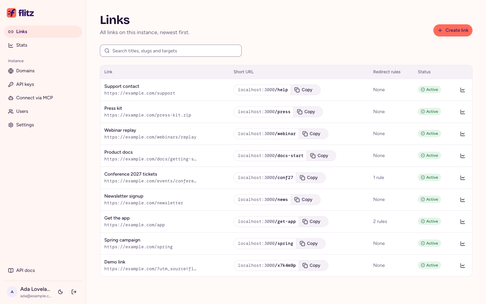

<p align="center">
  <picture>
    <source media="(prefers-color-scheme: dark)" srcset="docs/brand/flitz-lockup-dark.svg">
    
  </picture>
</p>

<h3 align="center">Short URLs that know where to go.</h3>

<p align="center">
  A self-hostable link shortener with redirect rules by device and country,<br>
  click stats that never store IP addresses, and an MCP server for AI agents.
</p>

<p align="center">
  <a href="https://michaelwolz.github.io/flitz/">Website</a> ·
  <a href="apps/server/docs/self-hosting.md">Self-hosting</a> ·
  <a href="apps/server/docs/getting-started.md">API</a> ·
  <a href="apps/server/docs/mcp.md">MCP</a>
</p>

<br>

<p align="center">
  
</p>

## What it does

One short URL, the right place for each visitor:

```
links.example.com/get-app
  iPhone         →  App Store
  Android        →  Google Play
  Everyone else  →  example.com/app
```

- **Redirect rules** by device (iOS, Android, mobile, desktop) or country. They run top to bottom and the first match wins. Presets cover app store links, mobile vs desktop and country splits.
- **Click stats without tracking.** No cookies, no fingerprinting, and IP addresses are never stored. Unique visitors are counted with a salt that is destroyed every day, and bot clicks are kept apart.
- **Built for AI agents.** Every API operation is also an MCP tool with the same scopes as an API key. Connect Claude, ChatGPT or Cursor with one sign-in.
- **Custom domains and QR codes**, one team per instance with admin, member and viewer roles, and scoped API keys.
- **One Docker image** next to Postgres and Redis, with docker compose or a Helm chart.

## Quick start

You need Docker.

```sh
git clone https://github.com/michaelwolz/flitz.git
cd flitz
docker compose --profile demo up
```

This builds the image and starts flitz, the click worker, Postgres and Redis. Open http://localhost:3000/app and sign up: the first person to sign up and verify their email becomes admin and can invite everyone else. Without SMTP configured, emails such as the verification link go to the server log while flitz runs on localhost (`docker compose logs server`).

The `demo` profile seeds a demo link, so this answers with a redirect to example.com:

```sh
curl -i http://localhost:3000/x7k4m9p
```

Before going public, follow the [self-hosting guide](apps/server/docs/self-hosting.md): it covers `BASE_URL`, `AUTH_SECRET`, `ADMIN_EMAILS` and email, every other setting, who may sign up, the Helm chart, custom domains and the proxy setup. Releases publish the image to `ghcr.io/michaelwolz/flitz` and the Helm chart to `oci://ghcr.io/michaelwolz/charts/flitz`.

## Development

[CONTRIBUTING.md](CONTRIBUTING.md) covers the setup, the commands CI runs, commit messages and releases; report security problems privately, as [SECURITY.md](SECURITY.md) describes.

| Path           | What's in it                                           |
| -------------- | ------------------------------------------------------ |
| `apps/server`  | Redirects, REST API, MCP server and the docs it serves |
| `apps/web`     | The web app (React, shadcn/ui)                         |
| `apps/site`    | The website, published on GitHub Pages                 |
| `packages/db`  | Database schema and migrations (Drizzle)               |
| `charts/flitz` | Helm chart                                             |
| `docs`         | Brand assets, design tokens and agent notes            |

The words flitz uses (link, instance, redirect rule, …) are defined in [GLOSSARY.md](GLOSSARY.md).

## License

flitz is open source under the [Apache-2.0](LICENSE). The Docker image bundles the [DB-IP](https://db-ip.com) Lite country database under CC BY 4.0, see [NOTICE](NOTICE).
