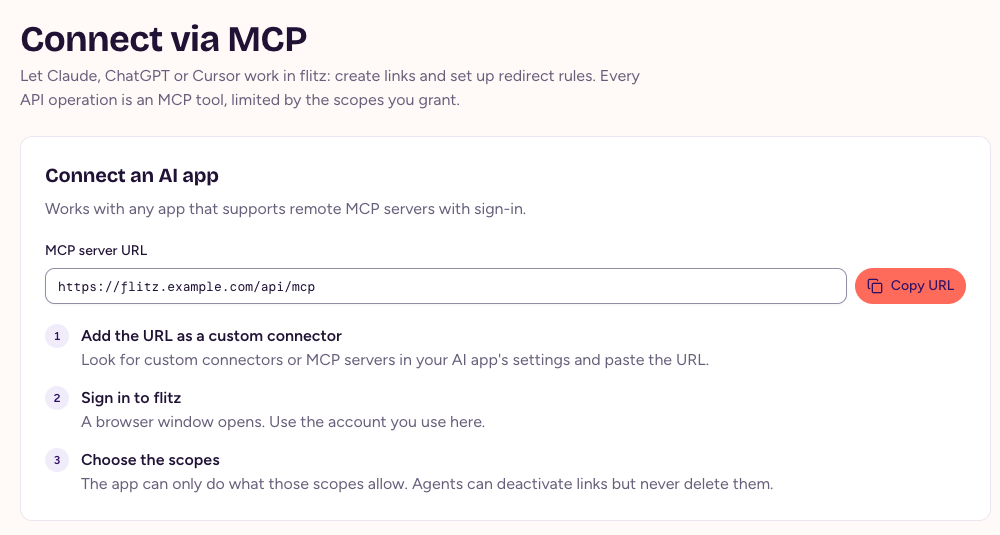
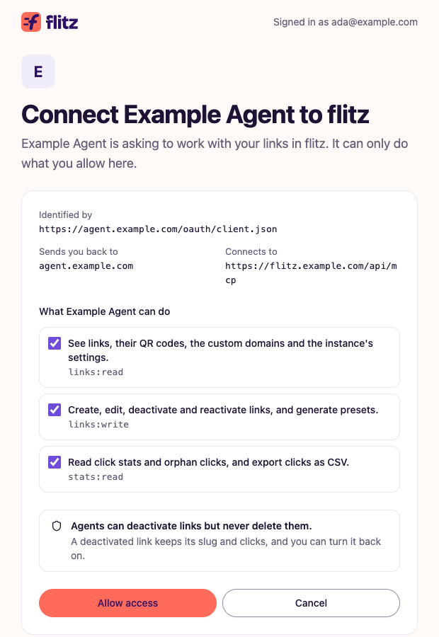

# Connect an AI agent

Let Claude, ChatGPT, Cursor or another AI app work in flitz for you: create links, set up redirect rules and read stats, asked in plain words. You decide what it may do.

## What an agent can do

flitz is an MCP server: every operation of its API is also an MCP tool that AI apps can call. You could ask your agent, for example: "Create a link for the trade fair that sends iPhones to the App Store and everyone else to example.com/fair", or "How did last month's spring sale link do?"

- An agent can only do what the scopes you grant allow, and never more than your role allows.
- Agents can deactivate links but never delete them. A deactivated link keeps its slug and clicks, and you can reactivate it at any time.

## Connect with a sign-in

Most AI apps connect with a sign-in, so you never copy a password or key into them.

1. In flitz, open **Connect via MCP** and choose **Copy URL** next to the **MCP server URL**.
2. In your AI app, add the URL as a custom connector or MCP server. The steps for Claude, ChatGPT and Cursor follow below.
3. A browser window opens. Sign in to flitz with the account you use in the web app.
4. Pick the scopes the app gets and choose **Allow access**.

<figure>
  
  <figcaption>Connect via MCP in the web app.</figcaption>
</figure>

<figure>
  
  <figcaption>The consent page shows which app asks and what it may do.</figcaption>
</figure>

### Claude

In Claude, open Settings › Connectors, add a custom connector and paste the MCP server URL. Then choose Connect and sign in to flitz.

### ChatGPT

In ChatGPT, turn on developer mode under Settings › Apps & Connectors › Advanced settings. Then create a connector with the MCP server URL and OAuth authentication, and sign in to flitz.

### Cursor

Add flitz to `~/.cursor/mcp.json`, or to `.cursor/mcp.json` in a project, with your MCP server URL. Cursor asks you to sign in to flitz the first time it connects.

```json
{
  "mcpServers": {
    "flitz": {
      "url": "https://flitz.example.com/api/mcp"
    }
  }
}
```

Other apps that support remote MCP servers with sign-in work the same way.

## Scopes

- `links:read`: see links, their QR codes, the custom domains and the instance's settings.
- `links:write`: create, edit, deactivate and reactivate links, and generate presets.
- `stats:read`: read click stats and orphan clicks, and export clicks as CSV.
- `domains:write` and `instance:admin`: manage custom domains, API keys and instance settings. Only admins can grant them.

## Disconnect an app

Open **Connect via MCP**. Under **Connected apps** you see each app with its scopes, who connected it and when it was last active. Choose **Disconnect** next to an app: it loses access right away and has to be connected again before it can act. Admins see and disconnect everyone's apps; everyone else sees their own. Resetting your password disconnects all your apps.

## Agents without a browser

Headless agents, scripts and CI can't sign in. An admin creates an API key on the **API keys** page with the scopes the agent needs, and the agent sends it in the Authorization header. The key is shown only once, and revoking it cuts the agent off at once. **Connect via MCP** shows a ready-made Claude Code command and JSON configuration for this; see the [MCP reference](mcp-reference.html#send-an-api-key) for the details.
