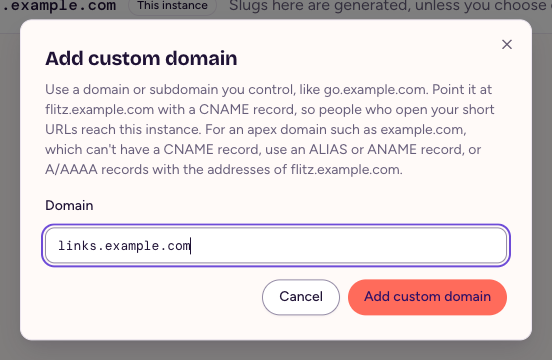
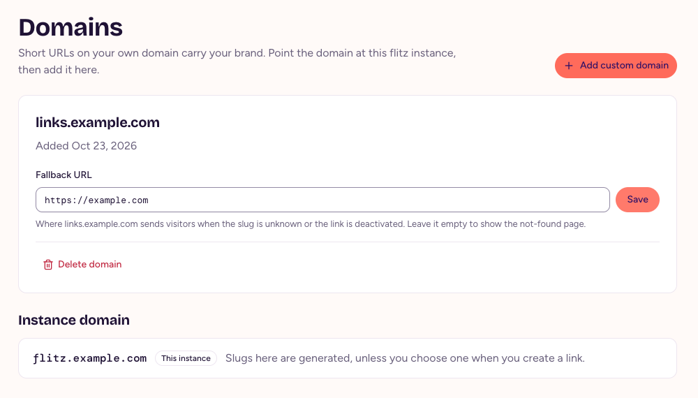

# Domains

Every link lives on a domain. Short URLs on your own domain, such as `links.example.com/spring`, carry your brand and tell people where a link comes from before they open it.

## The instance domain

The instance domain is the domain your flitz instance runs on, such as `flitz.example.com`. It serves short URLs from the start, and links use it unless you pick another domain. Its slugs are generated, unless you type your own when you create a link.

## Add a custom domain

Only admins add custom domains.

1. Pick a domain or subdomain you control, such as `links.example.com`.
2. At your DNS provider, add a CNAME record for it that points at your instance's domain. For an apex domain such as `example.com`, which can't have a CNAME record, use an ALIAS or ANAME record, or A/AAAA records with the addresses of your instance.
3. In flitz, open **Domains**, choose **Add custom domain**, enter the domain and choose **Add custom domain**.

<figure>
  
  <figcaption>The dialog tells you where the CNAME record has to point.</figcaption>
</figure>

flitz serves short URLs on the domain as soon as DNS points at the instance; it doesn't check who owns the domain. A custom domain serves only short URLs and QR codes, not the web app or the API. Whoever runs the instance makes sure it gets a TLS certificate for the domain, see [Reverse proxy, TLS and custom domains](self-hosting.html#reverse-proxy-tls-and-custom-domains).

When you create a link, pick the custom domain as its **Domain**. A link's domain can't change later.

## Fallback URL

A custom domain can send visitors to a **Fallback URL**, such as your website, when its slug is unknown or the link is deactivated. Without one, they see a not-found page. Whoever runs the instance can link their imprint and privacy policy in its footer, see [Settings](self-hosting.html#settings).

<figure>
  
  <figcaption>A custom domain with its fallback URL.</figcaption>
</figure>

## Delete a domain

Choose **Delete domain** to remove a custom domain you added by mistake. That only works while no link uses it, active or deactivated.
