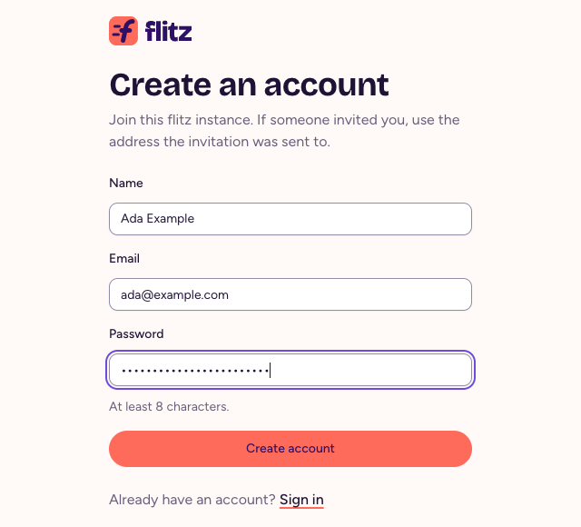
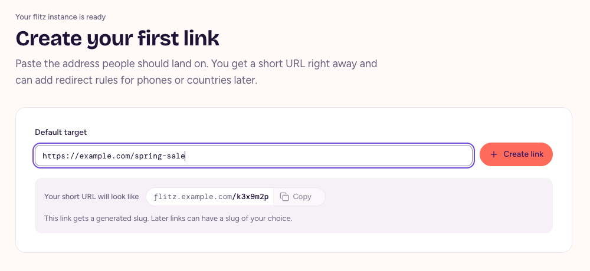
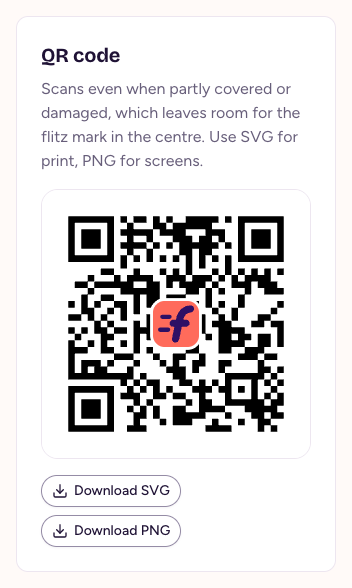

# Getting started

flitz turns long URLs into short URLs you can print, share and change later. This guide takes you from your account to your first short URL.

## Create your account

Open the web app of your flitz instance: `/app` on its address, such as `https://flitz.example.com/app`. Choose **Create an account** and enter your name, email and a password of at least 8 characters.

<figure>
  
  <figcaption>Create an account in the web app.</figcaption>
</figure>

flitz sends you an email with a link: open it to verify your address, and you're signed in. On an empty instance, the first person to sign up becomes admin. After that, people sign up when an admin invited them or when the instance allows their email domain, see [Users and sign-up](self-hosting.html#users-and-sign-up).

## Create your first link

1. Paste the **Default target**: the address people should land on.
2. Choose **Create link**.

<figure>
  
  <figcaption>Your first link gets a generated slug.</figcaption>
</figure>

flitz creates the short URL right away and opens the link, where you can give it a title and add redirect rules, see [Links and redirect rules](links.html).

## Share the short URL

Choose **Copy** next to the short URL to copy it. Every link also has a QR code: open the link's stats, from the chart icon in the link list or **Stats and QR code** on the link, and download it as SVG for print or PNG for screens.

<figure>
  
  <figcaption>The QR code encodes the short URL, so it keeps working when you change the target.</figcaption>
</figure>

## Next steps

- Send iPhones, Android phones or visitors from some countries to their own targets: [Links and redirect rules](links.html).
- Invite your team: admins invite people on the **Users** page and pick their role, see [Concepts](concepts.html#instance-and-access).
