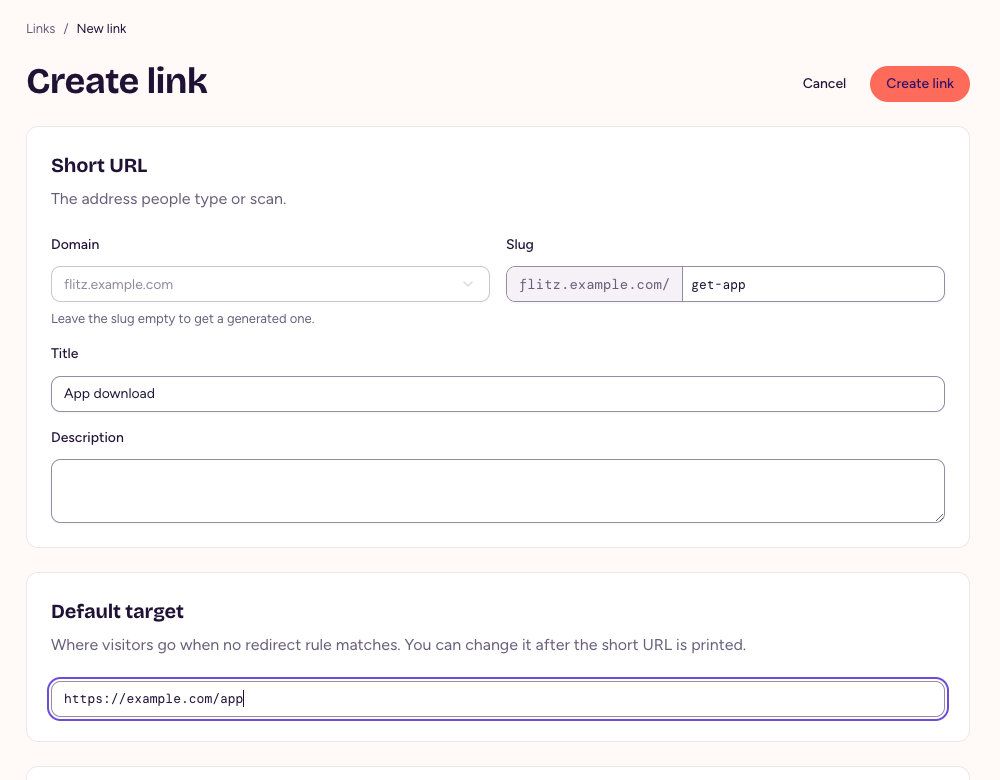
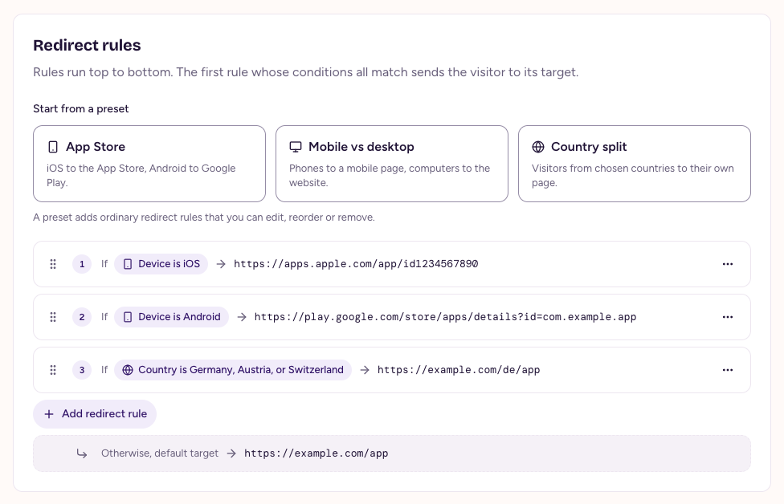
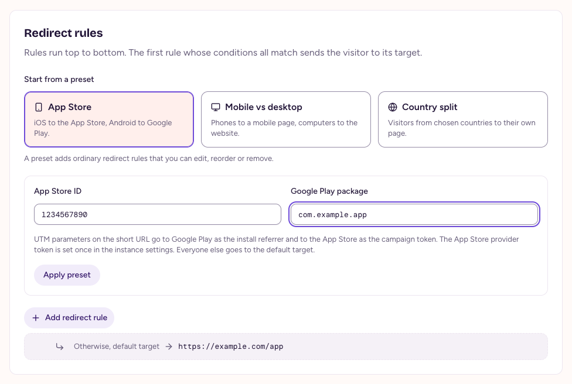

# Links and redirect rules

Every link has a short URL and a default target. Redirect rules send some visitors somewhere else, depending on their device or country. You can change targets and rules at any time, also after the short URL is printed.

Admins and members create and edit links; viewers can look but not change anything.

## Create a link

1. Open **Links** and choose **Create link**.
2. Pick the **Domain** if your instance has custom domains. Type a **Slug** of your choice, with letters, digits and hyphens, or leave it empty to get a generated one.
3. Give the link a **Title** and, if you like, a **Description**, so your team finds it in the link list.
4. Enter the **Default target**: where visitors go when no redirect rule matches.
5. Choose **Create link**.

<figure>
  
  <figcaption>Create a link with a slug of your choice.</figcaption>
</figure>

> **Domain and slug stay fixed**
>
> After a link is created, its short URL never changes, so printed short URLs and QR codes keep working.

## Add redirect rules

Rules run top to bottom. The first rule whose conditions all match sends the visitor to its target. Visitors that match no rule go to the default target.

1. In the link, choose **Add redirect rule**.
2. Pick a condition, **Device** or **Country**, and its value. **Add condition** adds another one that must match too.
3. Enter the **Target** and choose **Done**.
4. Choose **Save changes**.

<figure>
  
  <figcaption>Drag a rule by its handle to change the order, or use Move up and Move down in its menu.</figcaption>
</figure>

A link has at most 50 rules. Changes take effect at once: short URLs always answer with a temporary redirect, so browsers don't keep an old target.

### Conditions

- **Device**: iOS matches iPhones and iPads, Android matches Android phones and tablets, Mobile matches all phones and tablets, and Desktop everything else.
- **Country**: two-letter country codes, such as `DE, AT`. The country comes from the visitor's IP address, which flitz never stores. When the country is unknown, the condition doesn't match.

## Start from a preset

Presets add the rules for common cases. They are ordinary rules afterwards, which you can edit, reorder or remove.

- **App Store**: iOS to the App Store, Android to Google Play. Enter the App Store ID and the Google Play package.
- **Mobile vs desktop**: phones and tablets to one target, everyone else to another.
- **Country split**: visitors from the countries you pick to their own target.

<figure>
  
  <figcaption>The App Store preset.</figcaption>
</figure>

## Query parameters

Query parameters on a short URL, such as `?utm_campaign=spring`, are passed on to the target, unless the target already has a parameter of that name. On Google Play, the UTM parameters become the install referrer; on the App Store, `utm_campaign` becomes the campaign token. An admin sets the App Store provider token once in **Settings**, and the App Store preset adds it to App Store targets.

## Deactivate a link

To take a link offline, open it and choose **Deactivate**. Its short URL stops redirecting, but the link keeps its slug and its clicks, and you can reactivate it at any time. Visitors of a deactivated link land on the domain's fallback URL or on a not-found page.

Only an admin can delete a deactivated link, in the web app. That also deletes its clicks and frees its slug for a new link, so think twice before deleting a short URL that is still printed somewhere.

## With the API

Everything on this page also works through the REST API and as MCP tools, see [API quick start](api-quick-start.html) and [Concepts](concepts.html#links). A redirect rule looks like this:

```json
{ "conditions": [{ "type": "device", "device": "ios" }], "target": "https://apps.apple.com/app/id284882215" }
```
