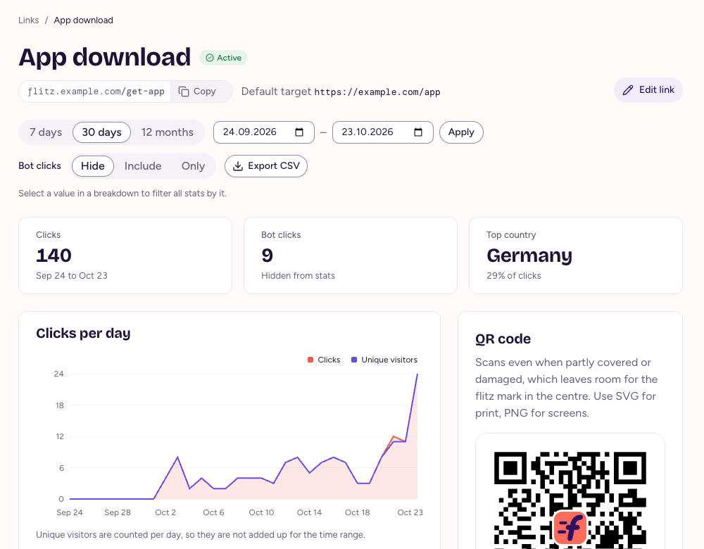
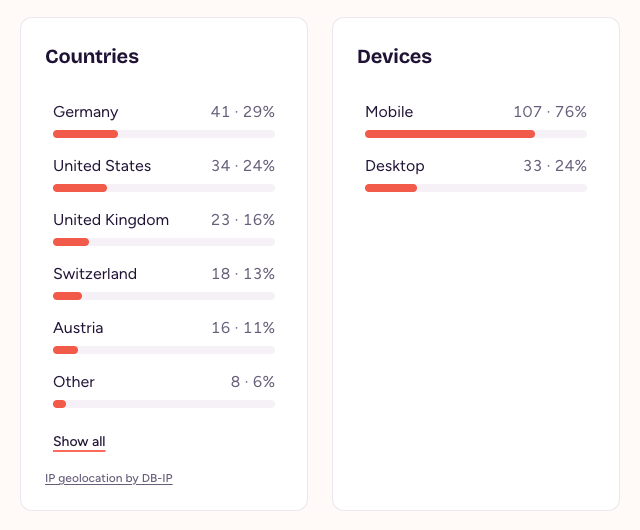

# Clicks and stats

flitz counts every click on a short URL and shows where your visitors come from, without cookies and without storing who they are.

## Stats for one link

Open a link from the link list with its chart icon, or choose **Stats and QR code** in the link. You see the clicks, the bot clicks and the top country for the time range, and the clicks and unique visitors per day.

<figure>
  
  <figcaption>Stats for one link over the last 30 days.</figcaption>
</figure>

Pick **7 days**, **30 days** or **12 months**, or set your own dates and choose **Apply**. Days follow the time zone an admin set for the instance.

## Breakdowns

Below the chart, **Audience** breaks the clicks down by country, device, operating system, browser and referrer. **Marketing** shows the UTM breakdowns. A UTM breakdown stays hidden when all its values are missing, and the Marketing section stays hidden when there are no UTM values. Select a value, such as a country, to filter all stats by it.

<figure>
  
  <figcaption>Clicks by country and by device.</figcaption>
</figure>

The UTM breakdowns use `utm_source`, `utm_medium`, `utm_campaign`, `utm_content` and `utm_term` from the short URL. Use `utm_content` to distinguish placements or variants within a campaign, such as `header_button` and `footer_link`, and `utm_term` for paid-search keywords. Parameters present only on the target URL do not appear in these breakdowns. You can filter by each UTM value, and the CSV export includes a column for each parameter.

In stats, a phone counts as mobile and a tablet as a tablet, and Safari on an iPad counts as desktop because it presents itself as a Mac. Redirect rules see devices a bit differently, see [Conditions](links.html#conditions).

## Stats for all links

**Stats** in the sidebar shows the same numbers for all links together, with the top links as one more breakdown. Its **Orphan clicks** list the slugs people requested that match no active link, which helps you find a mistyped short URL in print. Choose **Export CSV** on either page to download the clicks of the time range as a CSV file.

## What counts as a click

- **A click** is one request to an active link's short URL. flitz records its time, device, operating system, browser, country, referrer and query parameters.
- **Bot clicks** come from crawlers, link previews and email scanners. They are recorded but hidden from stats, so a link pasted into a chat doesn't inflate your numbers. Choose **Include** or **Only** next to **Bot clicks** to see them.
- **Unique visitors** are counted per day only. flitz can't tell whether clicks on different days came from the same person, so there is no unique visitor total for a time range.

## What flitz doesn't store

- **No cookies** and nothing else on the visitor's device.
- **No IP addresses.** flitz uses the IP address in memory to find the country and to count unique visitors, then drops it.
- **No way to follow a visitor across days.** Unique visitors are counted with a salt that changes every day and is then destroyed.

Clicks are deleted after the retention period: 13 months, unless an admin changes it in **Settings**. See [Concepts](concepts.html#clicks) for the exact definitions.
